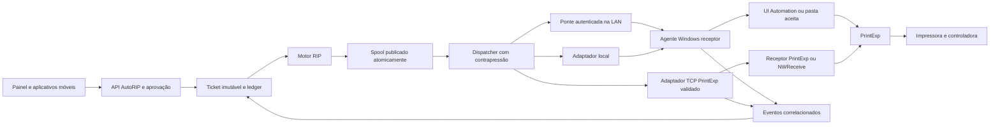
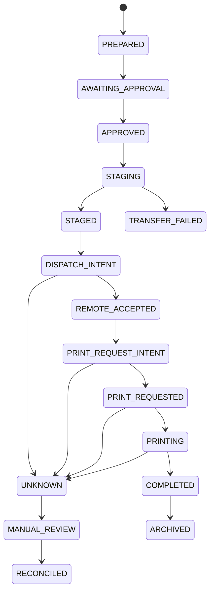

# Plano de integração AutoRIP → PrintExp

Data: 13/11/2026. Base: AutoRIP 0.8.25, commit `ed9ac95153aa01bb84e461e555866d21e394bf8f`.

A integração recomendada usa um dispatcher de saída no AutoRIP e um agente Windows próximo do PrintExp. Uma ponte autenticada permite enviar arquivos pela rede para o agente; um adaptador TCP nativo para o PrintExp pode ser habilitado quando o protocolo da versão instalada estiver identificado e testado. A escolha do transporte deve preservar o mesmo ticket e histórico de estados.

Este documento descreve implementação futura. O estudo não adicionou cliente TCP nem executou envio à impressora.

## Evidências e pendências

O [levantamento TCP existente](PRINTEXP-TCP.md) distingue a comunicação com a placa, a recepção de trabalhos do RIP e uma interface de plataforma. A revisão confirmou novamente as fontes públicas:

- O [guia de instalação Ricoma](https://support.ricoma.com/hc/en-us/articles/40213625226771-DTF-Aire-PrintExp-Hosonsoft-Software-Installation) apresenta a opção LINK TCP; ela não especifica o enquadramento dos trabalhos recebidos de outro RIP.
- O [Project.ini de uma distribuição de 2022](https://cncu.co.za/Other-Softwares/AM.CO.ZA%20PrintEXP%20Printer%20Control%20%26%20Alignment%20Software/PrintExp_X64_V5.7.6.5.103.BS_20220530/Project.ini) contém exemplos distintos: comunicação da placa em `5001`, configuração RIP/impressão em `9100` e interface de plataforma desabilitada com `5678/5679`. Esses números descrevem aquela distribuição; não são configuração recomendada para a instalação do usuário.
- [`agent/print_agent.py`](../agent/print_agent.py) já contém observação da pasta de saída, SQLite e UI Automation. Ainda não há transporte de trabalhos pela rede nem confirmação confiável vinculada ao trabalho atual.

### Instalação mostrada nas imagens do usuário

As duas telas fornecidas em 13/11/2026 mostram:

| Campo | Valor observado | Alcance da evidência |
| --- | --- | --- |
| Software Version | `5.7.6.5.122.R.BS` | Versão da interface PrintExp/Hosonsoft apresentada |
| MB Program Version | `5.7.6.5.65.R.BS` | Versão de programa da placa apresentada |
| Firmware Configure/Parameter Info | `EPSON-2H4C_DTF+W_D4-5.7.6.5.65_20221102` | Identificador exibido; não estabelece sozinho o mapeamento de canais do PRT |
| Communication set | `TCP` selecionado | Modo da tela Net Setting; a modalidade de recepção de trabalhos ainda precisa ser identificada |
| Ethernet | `Ethernet` | Adaptador selecionado na interface |
| Local IP | `192.168.0.215` | Endereço local exibido, a confirmar no sistema operacional |
| Server IP / Server port | `192.168.127.10:5001` | Valores exibidos em campos acinzentados; não demonstram um listener para trabalhos de outro RIP |

O destino e a porta coincidem com a seção de comunicação da placa na distribuição pública de referência. Isso sustenta a hipótese de comunicação PrintExp → controladora; a função efetiva e a conexão ativa devem ser confirmadas no computador. A indicação visual `Device Ready` não é uma verificação de rede realizada neste estudo. Endereços de sub-redes diferentes podem envolver máscaras, rotas ou interfaces adicionais não mostradas.

O [registro estruturado da observação](research/rip-study-2026-11-13/printexp-installation.json) separa dados visíveis e inferências. O plano não atribui automaticamente `5001` ao envio AutoRIP → PrintExp.

Dados ainda pendentes: processo e endereço/porta de escuta que recebem os trabalhos; modo de saída configurado no FlexiPrint; confirmação do papel da conexão da placa; um PRT aceito e uma troca de referência ou especificação/SDK do receptor. A versão do software e o modo TCP da tela já foram identificados visualmente e não precisam ser solicitados novamente.

## Arquitetura proposta



A ponte é um protocolo do AutoRIP para seu próprio agente; não é uma implementação presumida do protocolo nativo PrintExp. O agente deve continuar funcionando no computador de produção sem depender do aplicativo móvel permanecer aberto. Para UI Automation, é necessária uma sessão interativa adequada; a recepção de arquivos pode ser separada do executor de interface.

### Adaptadores

| Adaptador | Uso e dependência | Condição para promoção |
| --- | --- | --- |
| Pasta local/compartilhada | Reutilizar saída publicada e agente existente; eventual hot folder nativa depende do suporte da versão PrintExp | Consumo somente de arquivos completos e confirmação do trabalho correto |
| Ponte AutoRIP → agente Windows | Transferência autenticada para uma API nossa; destino local no computador do PrintExp | Integridade, limites de memória, ledger e recuperação validados; UI permanece desabilitada até concluir os testes da instalação |
| TCP nativo → PrintExp/NWReceive | Envio compatível com o receptor real usado pelo FlexiPrint | Framing, handshake, respostas, término, cancelamento e estados incertos demonstrados em fixtures e na instalação |

O IP do computador AutoRIP, o IP do receptor PrintExp e o IP da placa devem aparecer como campos distintos de configuração. A capacidade de estabelecer uma conexão TCP confirma alcançabilidade; a aceitação do arquivo e o resultado físico exigem eventos adicionais.

## Ticket e spool

O dispatcher deve consumir um manifesto versionado, por exemplo:

```json
{
  "schema_version": 1,
  "job_id": "UUID_DO_TRABALHO",
  "attempt_id": "UUID_DA_TENTATIVA",
  "destination_id": "PRINTEXP_CONFIGURADO",
  "source_job_id": "ID_DA_RIPAGEM",
  "filename": "arte.PRT",
  "size_bytes": 123456,
  "sha256": "HASH_SHA256_DO_ARQUIVO",
  "copies": 1,
  "device_profile_revision": "PERFIL_VALIDADO",
  "preset_revision": "RECEITA_APROVADA",
  "approval_state": "approved"
}
```

Os valores são exemplos de contrato proposto. A receita associada fixa DPI, tamanho, canais, branco, gotas, espelhamento, mídia, tinta e ICC/hash. Nome do arquivo e hash isolados não identificam a intenção: duas cópias deliberadas do mesmo PRT devem ser representadas por tickets distintos ou pela quantidade explícita de cópias.

Persistir a intenção antes da primeira ação externa e publicar o PRT integralmente antes de liberá-lo ao dispatcher. Reutilizar o hash de publicação quando disponível, preservando a verificação contra substituição do arquivo. A publicação atual com `fsync` e operação atômica deve continuar valendo no receptor. Arquivos parciais ficam em staging e não entram na fila do PrintExp.

Para a ponte própria, propor as operações `probe`, `stage`, `commit`, `status` e `cancel`, com versões e capacidades negociadas. Essas operações são um contrato nosso, não nomes de comandos comprovados do PrintExp. Tratar autenticação, autorização por destino e proteção contra repetição como parte da interface do agente; não reutilizar indiscriminadamente as sessões dos clientes móveis.

## Estados e recuperação



Cada transição deve carregar `job_id`, `attempt_id`, destino, estado anterior, sequência, horário e evidência. Um adaptador pode informar que não observa `PRINTING` ou conclusão física; nesse caso, o painel mantém “aceito pelo receptor” ou “impressão solicitada” até confirmação válida. “Arquivo transferido” não deve virar “impresso”.

Uma quebra após o comando externo pode tornar o resultado desconhecido, mesmo com ledger transacional local. A recuperação deve reconciliar esse estado com o receptor ou operador. Um novo envio só é automático quando o protocolo demonstrar que a operação anterior não foi aceita ou fornecer idempotência remota adequada. Reimpressões deliberadas recebem nova identidade e ficam no histórico.

Cancelar uma transferência em staging pode descartar o parcial. Depois da aceitação remota, a capacidade de cancelar deve ser declarada pelo adaptador; a interrupção física depende dos comandos efetivamente suportados pelo PrintExp/equipamento.

## Pré-requisitos no agente atual

Os problemas foram [reproduzidos com driver simulado](research/rip-study-2026-11-13/agent-findings.json), sem hardware:

1. Bloquear `revisao_manual` e outros estados incertos antes de chamar novamente `open_job` ou `start_print`. Definir reconciliação e reimpressão como ações distintas.
2. Persistir `PRINT_REQUEST_INTENT` antes do clique/atalho; ao reiniciar nessa fase, reconciliar a tentativa.
3. Identificar a linha ou objeto do trabalho correto. Usar ID/nome exato e transição de estado observada após a solicitação. Mensagens antigas ou de outro trabalho não confirmam conclusão.
4. Restringir diálogos e controles ao processo PrintExp correto, com seletores calibrados por versão. Validar sessão interativa, foco e níveis de integridade.
5. Evitar espera bloqueante e recálculo de hash em cada inspeção de arquivos já pendentes. Usar observação de mudanças com varredura de reconciliação, staging e fingerprints persistidos.
6. Integrar o status ao servidor e aos clientes; tratar a ausência do agente e o destino indisponível sem perder o ticket. O padrão de impressão automática permanece desabilitado até a etapa de validação correspondente.

## Identificação do protocolo nativo

Na máquina de produção, seguir a descoberta de listeners descrita em [PRINTEXP-TCP.md](PRINTEXP-TCP.md), vinculando porta e processo. Em seguida, obter uma referência autorizada FlexiPrint → receptor com um trabalho pequeno conhecido.

A coleta deve distinguir plano de controle e dados; identificar abertura, versão, nome/comprimento do trabalho, comprimentos dos blocos, ordem de bytes, checksums, confirmações, keep-alive e encerramento. Variar nome, tamanho, cópias e interrupção isoladamente. Capturar respostas e comportamento do receptor; delimitações de mensagens não podem ser inferidas dos limites de cada chamada `send`/`recv` em TCP.

Se houver especificação ou SDK, priorizar o contrato documentado. Caso seja necessário inferir comportamento, registrar cada hipótese como pendente, reproduzir a conversa em um servidor simulado e validar contra a versão real antes de habilitar o adaptador.

Compatibilidade do PRT é uma verificação separada: cabeçalho, DPI, largura/altura, bytes por linha, ordem de planos, bits por ponto e branco precisam coincidir com o modo de impressão aceito. A extensão `.PRT`, uma porta aberta ou a identificação de `NWReceive.exe` não estabelecem esse contrato.

## Desempenho de arquivos grandes

Transferir com blocos limitados e contrapressão, sem `read()` do PRT inteiro. Na ponte própria, negociar tamanho máximo, espaço disponível, checksum e identidade do parcial. Um teste com arquivo maior que 4 GiB deve cobrir contadores e framing sem truncamento; limites de tamanho do receptor nativo são pendentes de verificação.

Retomada por offset só é oferecida quando o receptor consegue provar a identidade e a integridade do prefixo. O adaptador nativo deve usar apenas a recuperação que seu protocolo realmente oferecer. Fechar o socket ou concluir `sendall()` não fornece confirmação de persistência ou impressão.

Medir separadamente geração, hash, staging, envio, espera por aceitação e impressão. O objetivo inicial de memória da ponte é crescimento independente do tamanho total do PRT; o limite absoluto deve ser escolhido por benchmark e configuração do agente. Medir com arquivos sintéticos de 1 GiB e maiores que 4 GiB e com filas de 1/100/1.000 pendências, sem invocar impressão.

## Marcos de implementação

| Marco | Entrega | Dependências e critério para concluir |
| --- | --- | --- |
| M0 — identificação | Inventário da instalação e mapa dos três endereços, receptor, porta e modo | Versão e configuração reais; referência de PRT aceito; nenhuma porta escolhida por suposição |
| M1 — agente confiável | Bloqueio de estados incertos, intenção persistida, confirmação correlacionada e identidade dos diálogos | Testes com timeout após envio, reinício após comando, arquivo alterado, mensagens antigas e duas cópias deliberadas |
| M2 — ponte de arquivos | Manifesto, staging, integridade, autenticação e estados consultáveis pelo painel | Receptor simulado; RAM limitada; arquivo grande; queda de conexão; falta de espaço; cópia parcial invisível ao PrintExp |
| M3 — caminho local homologado | Operação PrintExp por UI/pasta na versão instalada | Primeiro importar sem imprimir, confirmar dimensões/canais; depois trabalho físico pequeno e acompanhado, com resultado identificado |
| M4 — adaptador TCP nativo | Especificação inferida/documentada, parser e fixtures de conversa | Testes de leituras parciais, confirmação atrasada, respostas inválidas e desconexão; validação na instalação real |
| M5 — operação integrada | Estado e ações explícitas no desktop e nos aplicativos móveis | Histórico único, reimpressão identificada e recuperação após reinício; relatório de transferência e de qualidade física |

M1 pode começar com os dados já disponíveis. M2 pode ser implementado e validado com simulador enquanto a instalação é identificada. M3/M4 dependem dos dados e testes reais; M4 não precisa substituir a ponte já funcional.

## Decisões propostas

- Manter o motor RIP e a saída PRT independentes do transporte.
- Centralizar os estados no ledger, com eventos correlacionados do agente.
- Começar pela correção dos achados P0; depois implementar a ponte de arquivos e validar o caminho local.
- Habilitar TCP nativo mediante protocolo comprovado da versão instalada.
- Publicar uma implementação futura somente após os testes por etapa e a validação física correspondente. Este plano e seus diagnósticos não certificam compatibilidade com a impressora.

O [estudo comparativo](research/RIP-COMPARATIVO.md) reúne as referências dos RIPs, as melhorias propostas e o protocolo de avaliação de desempenho e qualidade.
