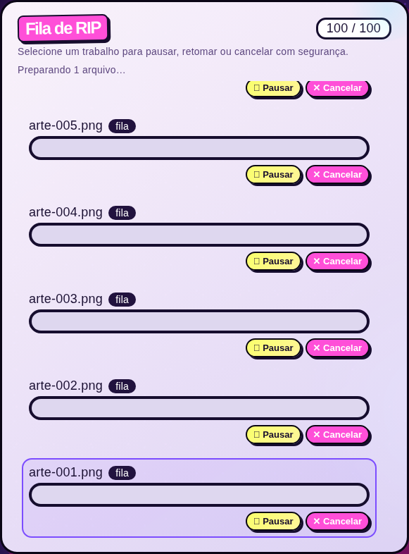

# Admissão com vaga reservada e preservação das artes

Continuação: [geração e carregamento de miniaturas](THUMBNAILS.md).
Os resultados abaixo permanecem como registro da etapa de admissão.

Base: `2593790`, após os [controles para lotes longos](JOB-QUEUE.md).
Esta etapa corrige entrada de arquivos, capacidade e concorrência com uploads.
Não altera `engine.py`, `prt.py`, `morph.py` ou `watcher.py` e não atribui um novo
fator de aceleração ao renderizador.

## Falhas reproduzidas

O teste inicial reproduziu oito falhas na base. A admissão manual da hot-folder
movia a arte antes de validar a largura e confirmar a capacidade. Um pedido
recusado deixava o arquivo em processamento, onde uma varredura automática
poderia admiti-lo com largura automática, sem a medida solicitada.

Uploads com a fila cheia só eram recusados após receber o corpo, verificar a
imagem e gravar os arquivos auxiliares. A recepção também mantinha o mesmo lock
usado pela recuperação manual do observador; um envio lento podia impedir
novas passagens da hot-folder.

## Mudanças

| Situação | Comportamento refinado |
| --- | --- |
| Largura inválida | Recusa antes de mover a arte ou receber o corpo |
| Fila cheia | Hot-folder permanece no lugar; upload recebe HTTP 429 antes da recepção |
| Duas admissões concorrentes | Uma reserva ocupa a vaga antes de qualquer movimento/recepção |
| Falha de disco, imagem, recepção ou publicação | Libera a reserva e limpa os temporários |
| Upload lento | Observador continua admitindo outras artes enquanto há capacidade |
| Uploads completos aguardando recuperação | Conservam imagem e largura até surgir vaga |
| Journal de PRT já publicado | Recuperação pode concluir mesmo com a fila cheia |

`_reserve_admission` reserva uma vaga sob `self.lock` e libera esse lock antes
do I/O. A reserva é convertida em trabalho na mesma seção crítica da admissão;
não é contada duas vezes. Seu encerramento libera uma reserva não consumida,
inclusive nas falhas. O limite de 100 conta trabalhos registrados **mais**
entradas em preparação, impedindo que outro produtor ocupe a vaga prometida.

A recepção de uploads continua serializada para verificar espaço de disco entre
envios. Um lock separado protege somente a publicação e a admissão da imagem.
Os bytes incompletos permanecem em `.upload.part`, que o observador não considera
arte disponível. O sidecar com largura e hash continua sendo persistido antes
da imagem final. Se a publicação/admissão falhar, a imagem é removida antes de
liberar o lock de recuperação, seguido da limpeza dos demais temporários.

O observador foi separado em `_watch`, que mantém o loop e intervalo existentes,
e `_scan_inputs`, que executa uma passagem testável. Sem capacidade, ele deixa
as novas artes na hot-folder e não recebe essa condição normal como falha geral.
Continua tentando finalizar journals e arquivamentos existentes. Uploads
completos aguardando recuperação conservam o sidecar e sua largura até surgir vaga.

Entradas em preparação também impedem o encerramento automático por inatividade.
A resposta autenticada inclui a quantidade em preparação; o painel a explica
sem reconstruir os cards quando os trabalhos não mudaram.



## Validação

**314 testes locais aprovados em 48,19 s**, incluindo 22 novos casos de admissão:

- parâmetros inválidos e fila cheia preservam os bytes e o local da arte;
- upload recusado não lê o corpo nem cria diretório;
- reserva bloqueia um concorrente, converte somente uma vez e é liberada nas falhas;
- falhas de recepção, imagem, disco, sidecar e publicação não deixam vagas ocupadas;
- teste com evento bloqueia a recepção de um upload e confirma que uma passagem
  da hot-folder admite outra arte; não usa comparação frágil de tempo total;
- observação com fila cheia mantém as entradas e não acrescenta avisos repetidos;
- recuperação posterior mantém a largura de 2,54 cm, e um PRT já publicado
  completa os metadados e arquivamento mesmo sem vaga nova;
- arquivo publicado por pedido recusado não fica visível ao liberar o lock;
- HTTP 429 e proteção do encerramento automático enquanto há preparação.

No Chromium/Playwright, o smoke existente de 100 trabalhos também verificou:
recusa HTTP 429, contador `100 / 100` com 99 ativos e uma reserva, aviso de
preparação, liberação para `99 / 100` e identidade dos cards preservada durante
essa mudança. Teclado, foco, rolagem, mobile, cancelamento e movimento reduzido
continuaram aprovados, com zero erros JavaScript.

[Resultado do navegador](../../benchmarks/campaign_runs/2026-11-09-admission/browser-results.json).
O smoke local v0.8.14 com login, upload, PRT 720 × 2400 dpi e encerramento passou.

```bash
python -m pytest -q tests/test_admission.py
python -m pytest -q
# Opcional, com Playwright/Chromium de desenvolvimento:
AUTORIP_PYTHON=.venv/bin/python node tools/smoke_queue_ui.cjs /tmp/queue-ui
```

Não acrescenta dependências de produção, configuração ou migração de journal.
As janelas de estabilidade, DPI, canais, ICC e modelo físico do branco permanecem.
Os ganhos de tempo anteriores continuam documentados nas respectivas campanhas.
