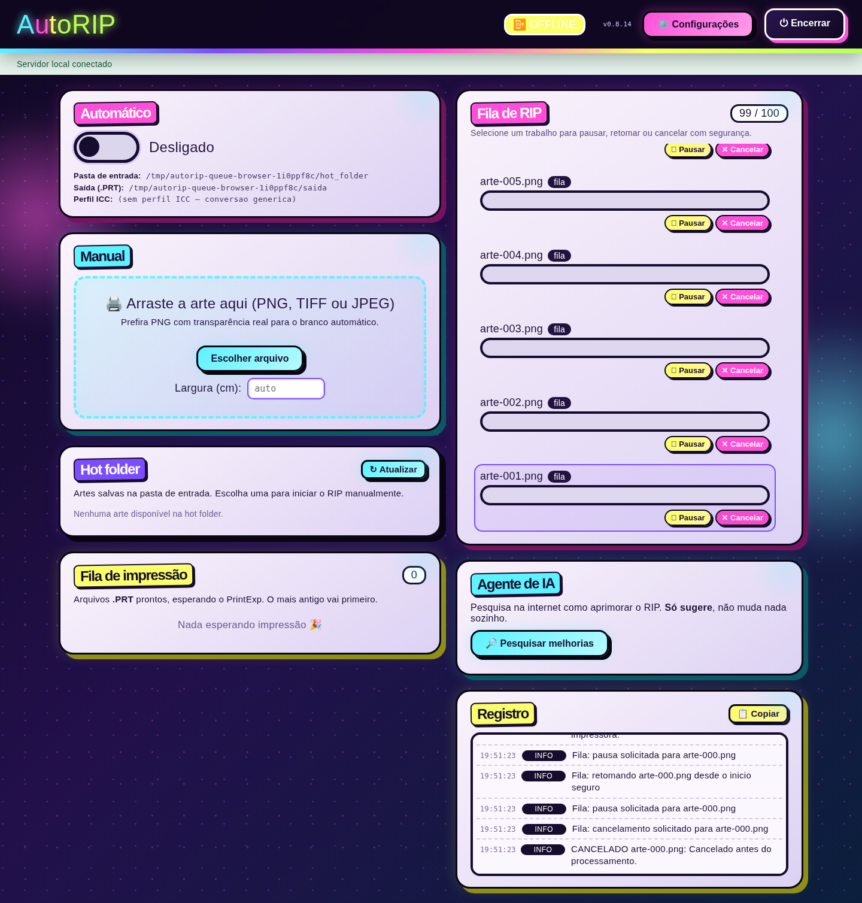

# Lotes longos: fila limitada e controles preservados

Continuação: [reserva de vagas e entrada de arquivos](ADMISSION.md).
Os resultados abaixo se referem à etapa de controle de trabalhos.

Base: `008decb`, posterior à [estabilidade em lote](BATCH-FLOW.md).
Esta etapa corrige capacidade, concorrência e navegação; não mede um novo fator
de aceleração do renderizador nem acrescenta rodadas às campanhas anteriores.
`engine.py`, `prt.py` e `morph.py` permanecem iguais à base.

## Falhas reproduzidas

O teste inicial reproduziu oito regressões na base:

- Ao admitir mais de 50 trabalhos, o histórico removia ativos antigos; o controle
  procurava o ID nessa lista e deixava de encontrá-los. `/api/state` mostrava
  somente os últimos 12 itens, ocultando outros trabalhos ainda pendentes.
- O limite de 100 verificava `qsize()`. Pausados já consumidos pelo worker
  permaneciam em memória, mas deixavam de contar e permitiam admissões ilimitadas.
- Pausar/retomar antes de o worker consumir a entrada adicionava outra cópia
  à fila. O mesmo trabalho podia ser executado novamente ou terminar em erro
  depois de já ter publicado um PRT.
- Cancelar um pausado já consumido apenas marcava o evento; sem uma entrada
  pendente para acordar o worker, ele ficava em `cancelando` e não liberava a vaga.

## Controle e limites

Admissão, retomada e cancelamento compartilham `_schedule_job`, protegido por
`self.lock`. O controle registra se já há uma referência pendente na fila.
O worker consome essa referência e decide entre executar, pausar e cancelar
na mesma seção crítica. Uma retomada entre `q.get()` e essa decisão usa a entrada
existente; não adiciona outra. Itens obsoletos de controles liberados são ignorados
antes de acessar arquivos.

O cancelamento acorda o worker quando necessário, é idempotente e bloqueia novas
ações de pausa/retomada sobre o mesmo trabalho. O arquivamento continua no worker,
preservando a entrada na pasta de erros ou no fallback existente. Cancelamento
durante uma exceção de pausa também termina e libera a capacidade.

O limite passa a contar fontes registradas, incluindo quem está processando,
pausado ou aguardando cancelamento. Repetir a admissão da mesma fonte não usa
outra vaga. Retomar um trabalho já admitido é permitido mesmo com a fila cheia.

| Recurso | Limite |
| --- | ---: |
| Trabalhos pendentes registrados | 100 |
| Histórico no servidor | Todos os ativos + 50 finalizados (até 150) |
| Estado autenticado enviado ao painel | Todos os ativos + 12 finalizados (até 112) |
| IDs de conclusão lembrados pelo navegador | Somente IDs presentes no estado atual |

Ao liberar a fonte, o trabalho vai para o fim do histórico. Assim, uma arte antiga
pausada que termina após as mais novas aparece entre as conclusões recentes.
Nenhuma configuração é migrada; os controles continuam em memória e os journals
de recuperação mantêm o formato existente.

## Painel e acessibilidade

A fila mostra a ocupação atual, incluindo pausados, e tem uma região de rolagem
limitada em altura, com nome acessível e navegação pelo teclado. Todos os ativos
continuam disponíveis. Atualizações preservam rolagem, seleção e foco no botão
equivalente; quando a ação muda de Pausar para Retomar, o foco acompanha a ação
disponível. Os cards são construídos em fragmento e inseridos em uma substituição
do DOM. Sem mudança de estado, o DOM existente é preservado.

O teste de movimento reduzido encontrou também a abertura bloqueando cliques:
`animation:none` impedia a animação de esconder `#intro`. Nesse modo, a introdução
agora fica oculta diretamente. A abertura animada normal continua encerrando.



[Captura mobile](assets/queue-100-mobile.png) e
[resultado estruturado do navegador](../../benchmarks/campaign_runs/2026-11-09-queue/browser-results.json).

## Validação

**292 testes locais passaram em 45,86 s**, incluindo 12 novos casos da fila.
Os testes dirigem o worker por passos, sem sleeps, para reproduzir transições
de pausa/retomada e cancelamento. Cobrem 100 pausados, limite cheio, admissão
duplicada, conclusão tardia, histórico limitado, estado com 100 ativos mais
12 concluídos, execução única e preservação da arte cancelada.

No Chromium/Playwright, o backend temporário mantém 100 trabalhos sintéticos,
enquanto o navegador usa as rotas reais de estado e controle. O worker é liberado
por um passo para cancelar e arquivar uma PNG real de teste. Foram verificados:

- 100 ativos visíveis e contador `100 / 100`;
- uma única substituição do DOM após mudar o progresso, preservando seleção,
  rolagem e foco; DOM intacto no polling sem mudança;
- pausa/retomada por Enter sem aumentar as 100 referências da fila;
- cancelamento preservando a arte e reduzindo a ocupação para `99 / 100`;
- ausência de overflow horizontal em 390 e 320 pixels;
- introdução oculta e zero animações com movimento reduzido, e encerramento
  da abertura no modo normal;
- cache de conclusões com 12 IDs após apresentar 600 conclusões sintéticas
  em grupos de 12, sem acumular IDs antigos;
- zero erros JavaScript.

O smoke local v0.8.14 também passou: login, upload, PRT 720 × 2400 dpi e encerramento.
Os ganhos anteriores de ripagem continuam como evidência histórica dos cenários
medidos; esta etapa evita trabalho duplicado e limita recursos, sem reduzir
DPI, canais, ICC ou o modelo físico do branco.

## Reprodução

```bash
python -m pytest -q tests/test_job_queue.py
python -m pytest -q
# Smoke de UI opcional: requer Node, Playwright e Chromium de desenvolvimento.
AUTORIP_PYTHON=.venv/bin/python node tools/smoke_queue_ui.cjs /tmp/queue-ui
```

O smoke usa somente dados temporários e não abre perfis/configurações reais.
`AUTORIP_CHROMIUM` seleciona um Chromium existente e `AUTORIP_PLAYWRIGHT_MODULE`
seleciona uma instalação de Playwright fora do projeto. Em contêiner sem sandbox
do navegador, `AUTORIP_NO_SANDBOX=1` habilita essa opção somente para o smoke.
Nenhuma dependência nova é exigida pelo programa empacotado.
