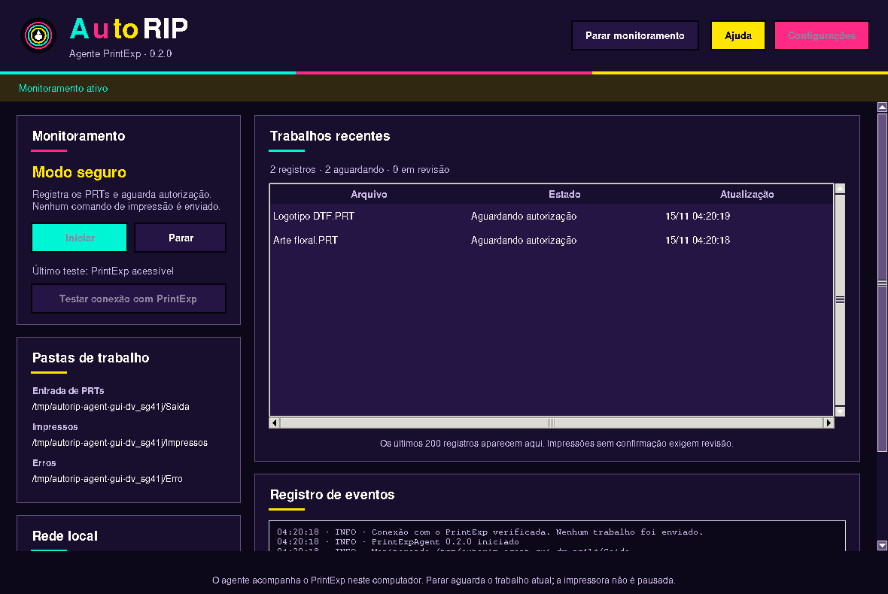

# Interface do agente PrintExp

Base: AutoRIP 0.8.29 (`8acdf18`). Entrega: PrintExpAgent 0.2.0 / AutoRIP 0.8.30.

O agente instalado anteriormente não tinha janela, apesar de ser compilado com
`--noconsole`. A nova interface Tk usa a marca e a paleta do painel AutoRIP,
funciona offline e não cria um servidor ou porta de administração.

Prévia em um display Linux de teste, com conexão PrintExp simulada e pastas
temporárias. O IPv4 exibido é um exemplo. Não representa uma impressão física.

## Funcionamento

Configurações, seletores nativos de arquivos/pastas, modo de operação,
monitoramento, teste de acesso ao PrintExp, IPv4, histórico e eventos ficam na
mesma janela. Há rolagem em telas menores e uma parada de monitoramento sempre
acessível no cabeçalho. A interface aplica apenas snapshots alterados e preserva
seleção/rolagem do histórico.

Uma única thread de automação mantém COM e SQLite no contexto correto; a janela
recebe snapshots por um controlador sincronizado. Operações de rede local não
tocam widgets fora da thread Tk. Alterar configurações exige monitoramento parado,
e salvar usa arquivo temporário, validação, fsync e substituição atômica.
Opções avançadas e o caminho do banco anterior são preservados.

`Parar` e fechar aguardam a operação atual. Eles não interrompem a impressora.
Estados de impressão pendente, carregamento interrompido e revisão bloqueiam
reenvios automáticos. Uma confirmação negativa preserva a arte para revisão.
O modo automático exige confirmação explícita ao ser habilitado no formulário.
Os padrões `auto_print: false` e `uipi_guard: true` permanecem.

## Validação

- Suíte completa: 1.326 testes locais aprovados.
- Regressões de controlador, worker, configuração antiga, locks, parada e ausência
  de reimpressão; CLI headless e rotas de entrada gráfica preservadas.
- Janela Tk real em display de teste: início/parada, dois PRTs em modo seguro,
  configurações, histórico e layout com rolagem a 860 × 600.
- Diagnóstico `--gui-smoke` cria a janela e verifica a marca. O runner de impressão
  é bloqueado por construção nesse modo. O workflow Windows executa esse
  diagnóstico no EXE compilado, além da descoberta IPv4 e do smoke do AutoRIP.
- Ícone e PNG da marca incluídos nos builds online e offline.

Não houve automação de PrintExp ou impressão física nesta rodada. A conexão no
teste visual é simulada; a versão/seletores do PrintExp e os privilégios do Windows
continuam exigindo validação na máquina da impressora.
