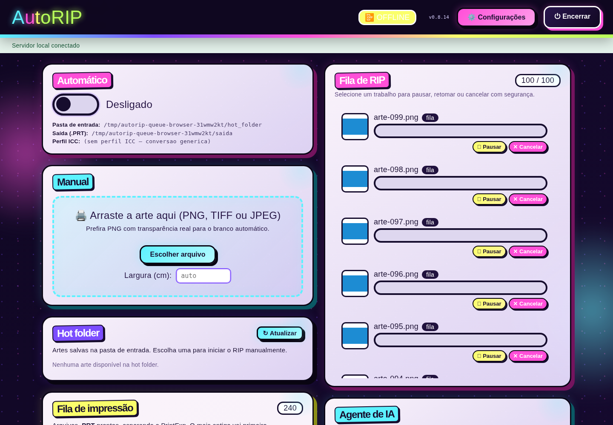

# Miniaturas: menos cópias, codificação única e carregamento sob demanda

Continuação na v0.8.18: [remoção do teto de pixels das artes](INPUT-PIXELS.md).
Os limites de entrada citados abaixo descrevem a etapa histórica.

Base: `57aea5b`, após a [admissão com vaga reservada](ADMISSION.md).
Esta etapa otimiza geração e consulta de miniaturas. Não altera o renderizador
de PRT, a estabilidade de entrada ou as janelas de espera das etapas anteriores.

## Geração no servidor

O caminho anterior copiava a imagem completa para tratar EXIF, convertia para
RGBA mesmo quando já era RGBA e só então reduzia para a miniatura. Também
codificava duas vezes o mesmo JPEG, para os destinos por ID e por nome.

`_load_thumbnail` valida o limite de pixels antes da decodificação e mantém a
mesma ordem de orientação/conversão/reamostragem. Orientações de 2 a 8 continuam
passando pelo EXIF transpose. Quando não há transformação, evita a cópia EXIF;
quando a imagem já é RGBA, reduz antes de copiar o buffer. A orientação da marca
d'água continua seguindo a regra anterior: não é aplicada automaticamente.

As duas publicações reutilizam uma única codificação JPEG de qualidade 82.
Cada destino mantém seu temporário, flush, fsync e substituição atômica.
Os dois arquivos contêm os mesmos bytes; uma falha de codificação preserva o
arquivo anterior. A consulta HTTP também rejeita uma raiz de cache que seja
link simbólico, coerente com a recusa de escrita nesse tipo de diretório.

## Medições do servidor

Linux, Python 3.12.14/Pillow 13.0.0. Sete repetições pareadas, ordem alternada
e aquecimento, incluindo geração, duas gravações e sincronização. Ambos os
destinos são comparados por SHA-256 em cada execução. O RSS é medido em workers
separados usando `VmHWM` do processo Linux atual, incluindo Python e bibliotecas.
Não representa o pico do aplicativo completo durante um RIP.

| Cenário | Base | Refinado | Fator | Pico RSS base → refinado |
| --- | ---: | ---: | ---: | ---: |
| RGBA 640 × 480 | 11,29 ms | 9,81 ms | 1,15× | 54,04 → 52,44 MiB |
| RGBA 4096 × 3072 | 262,45 ms | 245,32 ms | 1,07× | 195,09 → 147,25 MiB |
| JPEG RGB | 65,95 ms | 64,52 ms | 1,02×* | 123,26 → 123,36 MiB |
| JPEG com EXIF 6 | 91,54 ms | 95,11 ms | 0,96×* | 123,41 → 123,41 MiB |
| RGBA grande e marca | 334,55 ms | 306,98 ms | 1,09× | 195,08 → 147,27 MiB |

*Os intervalos pareados de 95% desses dois casos JPEG incluem 1, portanto
não há ganho confirmado neles. O JPEG orientado teve mediana 3,9% maior nesta
bateria; não se afirma aceleração de todos os formatos. Os três cenários RGBA
ficaram com limite inferior do intervalo acima de 1. O conjunto medido teve
fator geométrico de 1,057×. Os JPEGs finais permaneceram idênticos à base.

No RGBA grande, o pico isolado caiu cerca de **47,85 MiB (24,5%)**. A arte tem
12,6 milhões de pixels; o benefício depende de modo, tamanho e orientação.
Não há redução de resolução, qualidade JPEG, transparência ou marca d'água.

## Carregamento no navegador

O painel usa IntersectionObserver com margem de 160 pixels para pedir imagens
visíveis ou próximas. Requisições da mesma sessão/URL compartilham o trabalho,
inclusive quando novos cards substituem os antigos durante o carregamento.

- Até **quatro tarefas de fetch** simultâneas; a fila só inicia outra após a anterior terminar.
- Cache de blobs limitado a **64 entradas e 8 MiB** de soma de payloads, com LRU
  e expiração em 60 segundos. Não é um limite da RAM total do navegador: imagens
  decodificadas, DOM e requisições em andamento consomem memória adicional.
- Nós removidos saem do observador e das filas; trabalho sem consumidores é abortado.
- Troca de sessão limpa pendências/cache e aborta buscas antigas. Uma resposta
  antiga não pinta a imagem da nova sessão. URLs de blobs são revogadas ao carregar ou falhar.
- Sem IntersectionObserver, o carregamento continua funcionando com o mesmo
  limite de concorrência; esse fallback não adia imagens fora da tela.
- Miniaturas de trabalhos têm quadro fixo de 64 × 64 com `object-fit:contain`,
  preservando a proporção e evitando deslocar os controles durante a carga.

No smoke com **100 cards de trabalhos e 240 PRTs**, havia 340 imagens no DOM.
A interface da base pediu 290 URLs únicas; a nova pediu **5 no carregamento
inicial** da mesma viewport de 1440 × 1000, redução de 98,3%. O teste encontrou
332 imagens ainda adiadas. Após rolar a lista de trabalhos e ir ao último PRT,
o total chegou a 24 requisições, com máximo observado de quatro simultâneas.
Esse resultado se refere à navegação testada; percorrer toda a fila pode carregar
todas as imagens. Os cards continuam no DOM: não se trata de virtualização da lista.



[Captura mobile](assets/thumbnails-mobile.png).

## Validação e reprodução

**382 testes locais passaram em 51,00 s**, incluindo comparação exata dos pixels
com a referência Pillow em **64 combinações** de modos/formatos e orientações
1–8: RGBA, RGB, LA, paleta, PNG, JPEG, CMYK e TIFF. Há testes adicionais de marca,
codificação única, limite antes do load, publicação e raiz de cache por symlink.

O smoke de miniaturas valida requests compartilhados durante troca de cards,
DOM intacto sem atualização, limpeza após 30 renderizações, limites em bytes e
entradas, expiração, aborto em voo ao trocar sessão, ausência de pintura tardia,
fallback sem observador e mobile 390/320, com zero erros JavaScript. O smoke
completo de controles de fila e o launcher v0.8.14 também passaram.

- [Dados do benchmark e SHA-256 dos JPEGs](../../benchmarks/campaign_runs/2026-11-09-thumbnails/report.json).
- [Resultado estruturado do navegador](../../benchmarks/campaign_runs/2026-11-09-thumbnails/browser-results.json).

```bash
python benchmarks/benchmark_thumbnails.py --baseline-ref 57aea5b --output /tmp/thumbs.json
python -m pytest -q
# Opcional: requer Node, Playwright e Chromium de desenvolvimento.
AUTORIP_PYTHON=.venv/bin/python AUTORIP_UI_BASELINE=57aea5b node tools/smoke_thumbnail_ui.cjs /tmp/thumbnail-ui
```

O ambiente gerado usa arquivos sintéticos, sem dados reais ou impressora.
Os seletores opcionais de Python, Playwright e Chromium seguem o smoke de fila.
Não acrescenta dependências ao programa empacotado, perfis ou migrações.

Continuação: [consultas agrupadas e linhas estáveis durante uso prolongado](POLLING.md).
